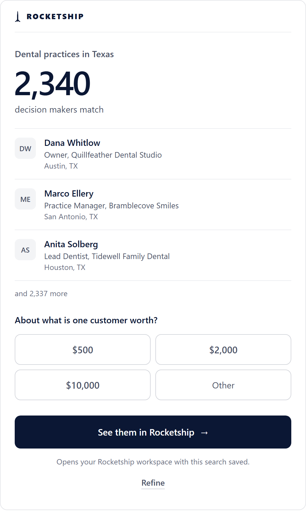

# Rocketship

Rocketship gets you customers. This plugin lets Claude find your buyers, reach them from your own Gmail, and tell you who replied, step by step, inside your own Rocketship account.

It bundles the Rocketship connector with four skills that teach Claude how to use it well: ask the right question first, show you your market for free, ask before anything that uses credits, and send nothing until you say start.

Works in Claude chat (web, desktop and mobile), Cowork and Claude Code.

## What's inside

| Skill | What Claude does |
| --- | --- |
| Find first customers | Asks what you sell and who buys it, in one question. Shows your market for free: about how many decision makers match, three of them by name, and a button that opens the search in Rocketship. Shows more people when you want them. |
| Start outreach | Adds the people you pick and finds their emails (it asks first, because that uses credits). Writes a short email with follow-ups together with you, and starts it only when you say so. You answer the replies to a campaign written here. Or points you to Rocketship's AI salesperson, set up in Rocketship, which writes to each buyer, follows up, answers replies and books meetings on its own. |
| Check results | Today at a glance, who replied, what was sent, how each campaign is doing, and your pipeline, in a few plain lines with one next step. |
| Reply to conversations | Reddit and Quora threads where people ask for what you sell, with the reply Rocketship drafted and the link. You post from your own account. |

The plugin uses the Rocketship connector at https://deployrocketship.com/mcp. If you also added the Rocketship connector on its own, Claude still sees one set of tools.

## What you see

On claude.ai and in the Claude desktop app, your market shows up as a card: about how many decision makers match, three of them, and a button that opens the search in Rocketship. In Claude Code, the same answer comes as text with a link.

Example only. The names, businesses and numbers on this card are made up.

## Get started

1. Add the Rocketship plugin: on claude.ai or in the Claude desktop app, from Customize, then Plugins. In Claude Code, run `/plugin directory` and pick Rocketship.
2. Connect Rocketship. On claude.ai or in the desktop app, open the plugin's Connectors tab and select Connect (on a Team or Enterprise plan, an Owner adds the connector first). In Claude Code, run `/mcp` and sign in to rocketship.
3. Sign in with your Rocketship account, or create one on the sign-in page.
4. Ask Claude: "Find my first customers."

## Try asking

- "Find my first customers. I sell appointment reminders to dental offices in Austin, Texas."
- "How many owners of roofing companies are there in Ohio?"
- "Show me 25 of them."
- "Add the first 10, then write a short email with two follow-ups. Show me before you start anything."
- "Start the campaign."
- "Who replied this week?"
- "What's in my pipeline?"
- "Any Reddit threads I should reply to?"

## What's free and what needs a plan

- Free with a Rocketship account: seeing about how many buyers match, and a few of them by name, title, company and place (within a daily limit).
- Everything else needs a Rocketship plan: adding people, finding their emails and phone numbers (this uses credits, and Claude asks first), writing and sending campaigns, checking replies and your pipeline, and Conversations. See the plans at https://deployrocketship.com/pricing.
- Sending needs your Gmail connected in Rocketship.

## Safe by design

- Nothing is sent until you say start. Starting a campaign sends real emails from your own Gmail, inside your sending hours and daily limits.
- Claude asks before anything that uses credits.
- Claude reaches only the Rocketship workspaces you can open, with the same permissions, plan limits and safety switches as the Rocketship app.
- Before the first email, Rocketship's AI salesperson reads each buyer's own website, and it never invents facts about them. The skills tell Claude the same: only what the tools returned, no made-up facts, no promised results.
- Through this plugin, Claude never posts, comments or sends messages on Reddit, Quora or LinkedIn.

## Data

- The plugin itself is text: a manifest, the connector address and four skills written as plain instructions. It runs no code, has no scripts or hooks, and stores nothing.
- Everything goes through the Rocketship connector at https://deployrocketship.com/mcp, which you sign in to with OAuth. Your Rocketship password never reaches Claude.
- Claude sends Rocketship only what each request needs: for example the job titles, kinds of business and places you describe, the people you choose to add, the emails you write, and start or pause requests. Rocketship sends back counts, people (name, title, company, place, and emails once found), your campaign, reply and pipeline numbers, and the Reddit and Quora threads Conversations found, with their drafted replies.
- Rocketship does not read your Claude conversations, memory or files.
- Data is handled under the Rocketship Privacy Policy, which has a section on Claude: https://deployrocketship.com/privacy
- To end the connection, remove Rocketship in Claude's connector settings, or in Rocketship open Settings, then Connected accounts, then Connected AI assistants, and choose Disconnect.

## Help

- Guide: https://deployrocketship.com/claude
- Help center: https://deployrocketship.com/help
- Email: support@deployrocketship.com
- Contact: https://deployrocketship.com/contact
- Terms: https://deployrocketship.com/terms

## License

MIT. See LICENSE.
